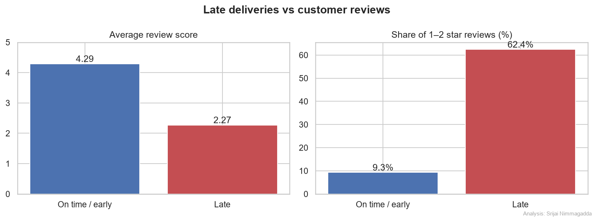
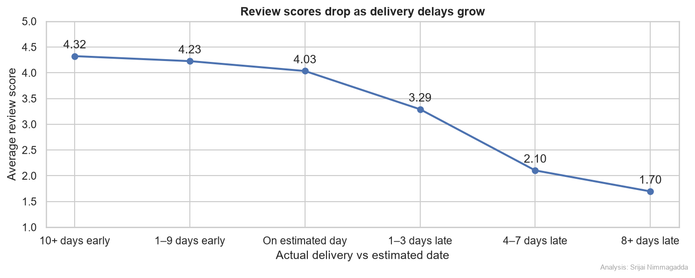
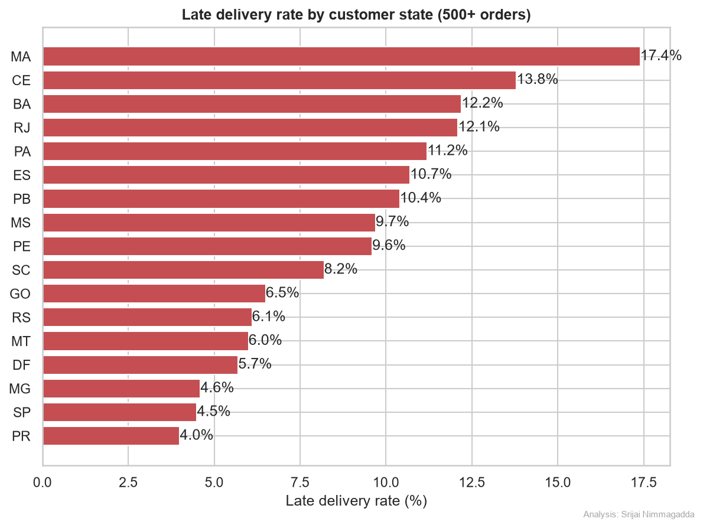
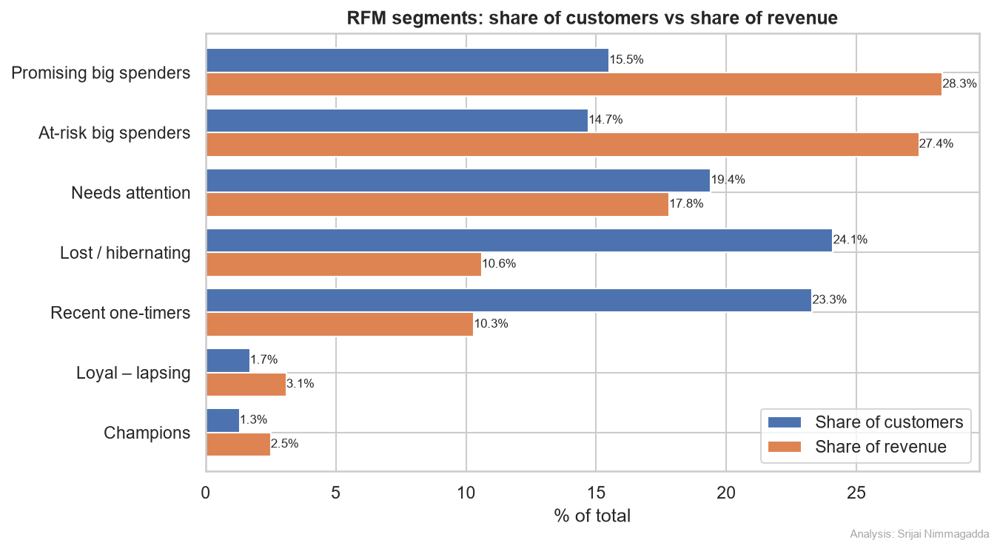
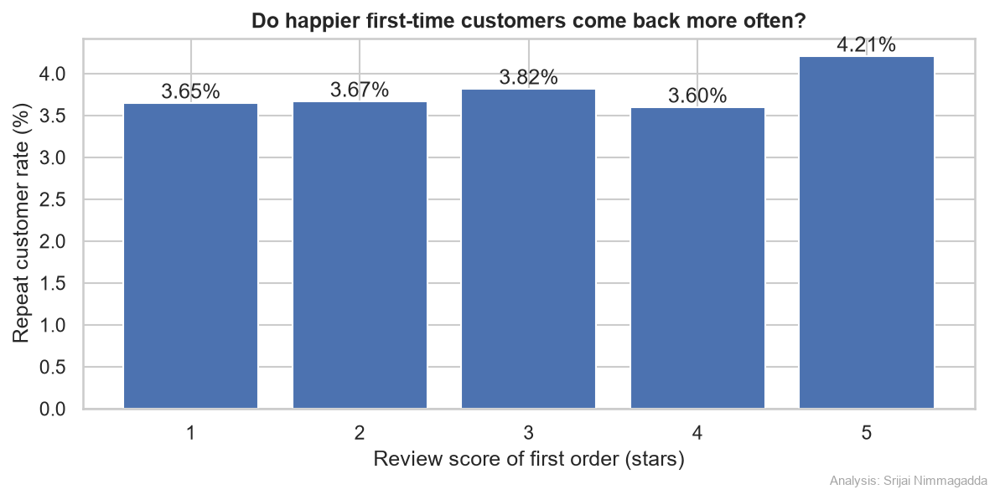
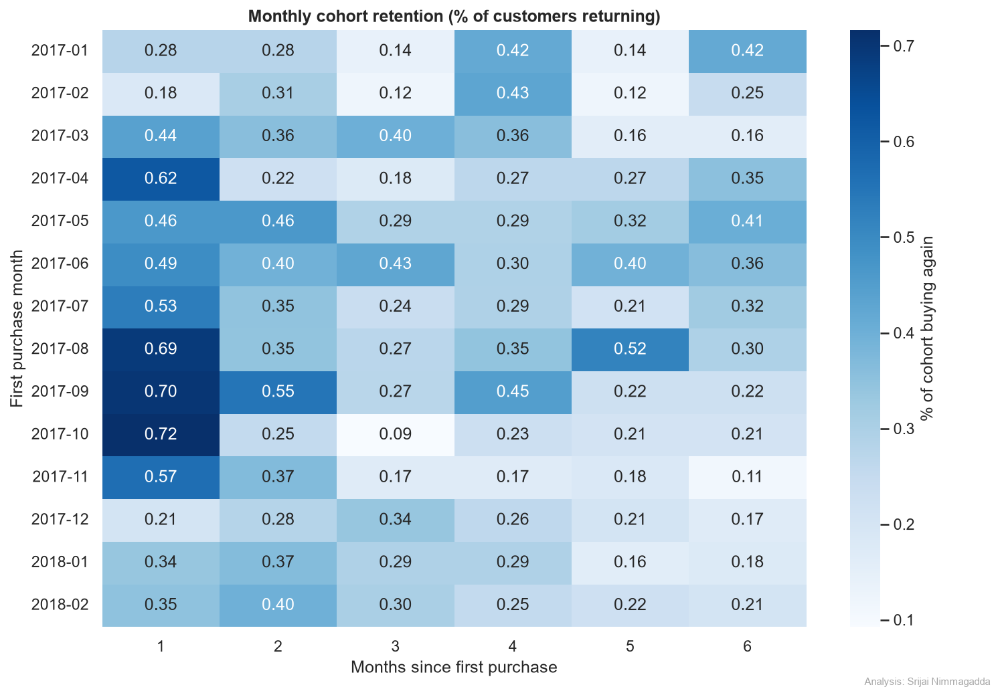

# Olist E-Commerce: Customer Retention & Delivery Experience Analysis

An end-to-end Python analysis of ~96,000 real orders from Olist, a Brazilian e-commerce marketplace, investigating how delivery performance affects customer reviews and repeat purchases.

**Analysis by [Srijai Nimmagadda](https://www.linkedin.com/in/srijai-nimmagadda)** ·

## Key Results
- Late deliveries are **6.7% of orders** but cause **32.5% of all negative reviews**
- Late orders average **2.27 stars vs 4.29** for on-time orders, and are **6.7× more likely** to receive a 1–2 star review
- Only **3% of customers** ever place a second order
- Customers whose **first order arrived late are ~25% less likely to return** (p = 0.0033)
- **30% of customers generate 56% of revenue**; 13,737 high-value customers (R$4.2M) are at risk of churning

## Business Questions
1. Do late deliveries lead to worse customer reviews?
2. Which regions experience the most delivery delays?
3. Who are the most valuable customers, and how many return?
4. Does a customer's first-order experience affect whether they come back?

## Dataset
## Dataset
[Brazilian E-Commerce Public Dataset by Olist](https://www.kaggle.com/datasets/olistbr/brazilian-ecommerce) (Kaggle): 99,441 orders from 2016–2018 across 9 relational tables.

The raw CSV files are included in `data/raw/` so the project runs straight after cloning, and the cleaned tables are in `data/processed/`.
Data © Olist, shared under the [CC BY-NC-SA 4.0](https://creativecommons.org/licenses/by-nc-sa/4.0/) licence; credit for the data belongs to Olist.

## Tools
Python · Pandas · NumPy · Matplotlib · Seaborn · SciPy · Jupyter

## Project Structure
```
├── notebooks/
│   ├── 01_data_exploration.ipynb          # table sizes, quality checks, relationships
│   ├── 02_data_cleaning.ipynb             # cleaning, feature engineering, master table
│   ├── 03_delivery_vs_reviews.ipynb       # delivery delays vs reviews, statistical tests
│   ├── 04_customer_segmentation_rfm.ipynb # RFM scoring and customer segments
│   └── 05_retention_analysis.ipynb        # first-order experience, cohort retention
├── images/                                # charts used in this README
├── requirements.txt
└── README.md
```

## Methodology
- **Data cleaning:** merged 5 tables into one row per delivered order; aggregated items and payments per order before merging to avoid double-counting revenue; investigated missing values by cause (e.g. 8 orders marked "delivered" with no delivery date were excluded).
- **Feature engineering:** delivery time, delay vs estimated date, late-delivery flag, delay buckets.
- **Statistical testing:** Mann-Whitney U test (review scores are ordinal, not normally distributed) and chi-square tests.
- **RFM segmentation:** recency and monetary scored by quintiles; frequency scored by rules, since 97% of customers have one order.
- **Retention analysis:** first-order outcomes vs repeat purchases (limited to customers with 6+ months of follow-up to avoid bias), plus monthly cohort retention.

## Findings

### 1. Late deliveries drive negative reviews


Review scores fall steadily as delays grow, from 4.32 (10+ days early) to 1.70 (8+ days late). Even a 1–3 day delay raises the negative review rate from 12.4% to 32.1%.



### 2. Delays are concentrated in distant states


MA (17.4%), CE (13.8%) and BA (12.2%) have the highest late rates and the longest delivery times, compared with 4.5% in SP. Median orders arrive 12 days *before* their estimated date, so delivery estimates are very conservative.

### 3. Revenue depends on a minority of customers


### 4. A bad first delivery reduces repeat purchases




Average month-1 retention is just 0.47%. *Note: these results show association, not causation.*


**Summary:** Late deliveries are just 6.7% of orders but cause 32.5% of negative reviews, and customers whose first order is late are 25% less likely to return. With only 3% of customers buying twice, fixing first-order delivery is one of Olist's clearest retention levers.

## Recommendations
1. Prioritise logistics improvements for North-East states and RJ, where late rates are 2–4× higher than SP.
2. Treat on-time delivery of the first order as a retention priority; follow up on late first orders with an apology and a discount.
3. Run a win-back campaign targeting the 13,737 at-risk high-value customers.
4. Introduce second-purchase incentives and loyalty rewards, as only 3% of customers currently return.
5. Make delivery estimates more accurate; shorter, realistic promises could improve conversion.

## How to Run
```bash
git clone https://github.com/Srijai-0225/olist-customer-analytics.git
cd olist-customer-analytics
python -m venv .venv
.venv\Scripts\activate        # Mac/Linux: source .venv/bin/activate
pip install -r requirements.txt
```
Download the dataset into `data/raw/`, then run the notebooks in order (01 → 05).


## Author
**Srijai Nimmagadda**
- LinkedIn: [linkedin.com/in/srijai-nimmagadda](https://www.linkedin.com/in/srijai-nimmagadda)
- Email: [nimmagaddasrijai@gmail.com](mailto:nimmagaddasrijai@gmail.com)

*Open to Data Analyst and Business Analyst roles. Feedback and questions are welcome.*